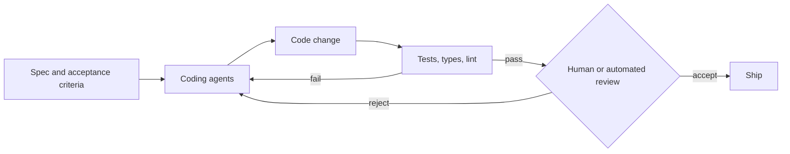

## Introduction

A software factory is a development setup where coding agents do the
implementation work and people supply the intent. Engineers write specs and
acceptance criteria. Agents write the code, run the checks, and repeat until the
result passes.

The term covers a wide range. At one end, a person still approves every change.
At the other end, nobody reads the code at all. This post explains the range,
looks at two teams that run a factory and one that builds the harness under it,
and lists the practices that transfer to a small team.

Every number below comes from the company that published it. None has been
verified by a third party.

## Light factory and dark factory

Dan Shapiro's post
[The Five Levels: from Spicy Autocomplete to the Dark Factory](https://www.danshapiro.com/blog/2026/01/the-five-levels-from-spicy-autocomplete-to-the-software-factory/)
(January 23, 2026) gives a widely cited scale. It borrows from the levels of
driving automation.

<!-- markdownlint-disable MD013 -->

| Level | What the person does                                                        |
| ----- | --------------------------------------------------------------------------- |
| 0     | Writes all the code. AI offers the occasional suggestion                    |
| 1     | Writes the important code and hands small, discrete tasks to AI             |
| 2     | Pairs with AI and delegates routine work, but stays in charge of the code   |
| 3     | Manages. Most of the day goes to reviewing the code that AI produces        |
| 4     | Writes specs and plans, leaves the agent unattended, then checks the result |
| 5     | Stays out of the process. Specs go in and software comes out                |

<!-- markdownlint-enable MD013 -->

Level 5 is the **dark factory**. The name comes from lights-out manufacturing
plants, where robots work without people on the floor. This post uses **light
factory** for the same pipeline with a person still approving changes, which is
roughly levels 3 and 4. The term is informal, and none of the sources below use
it.

## The loop inside a factory

Whatever the level, the loop has the same parts. The difference is who sits at
the review step.



## StrongDM: no human writes or reviews code

[StrongDM's Software Factory](https://factory.strongdm.ai/) is the reference case
for level 5. The team started on July 14, 2025, with three people, and works
under two rules: people do not write code, and people do not review code.

Removing review means something else has to catch bad output. StrongDM describes
three mechanisms.

- **Scenarios instead of tests.** A scenario is an end-to-end user story, often
  stored outside the codebase. An agent that cannot see the scenario cannot write
  code that only satisfies the check. The idea is the same as a holdout set in
  machine learning.
- **Satisfaction instead of a green build.** The team does not ask whether every
  test passed. It asks what fraction of the observed runs through all scenarios
  would likely satisfy a user. The answer is a probability, not a yes or no.
- **A Digital Twin Universe.** Agents built behavioral clones of the third-party
  services the product depends on: Okta, Jira, Slack, Google Docs, Google Drive,
  and Google Sheets. Scenarios can then run at a volume, and with failure
  conditions, that the live services would not allow.

For one product, the spec is the release.
[Simon Willison reports](https://simonwillison.net/2026/Feb/7/software-factory/)
that the repository for
[Attractor](https://factory.strongdm.ai/products/attractor), the team's coding
agent, holds Markdown specs and no code. You give the specs to your own agent
and let it build the implementation.

The cost is high. StrongDM says a factory has room to improve if it spends less
than \$1,000 on tokens per engineer per day. Willison notes that this could reach
about \$20,000 per engineer per month, and that the budget turns the approach
into a business-model question.

## Uber: a light factory at scale

Uber's
[Running a Software Factory Efficiently at Uber Scale](https://www.uber.com/us/en/blog/efficient-software-factory/)
(August 27, 2026) describes the other end. Agents handle code review, CI
repair, end-to-end pull requests, on-call triage, and code maintenance. People
still review and can take over.

Uber reports these figures:

- More than 70% of pull requests are attributed to local or cloud agents.
- Engineers built over 3,600 agent skills, with more than 30,000 skill
  executions per day.
- From February to August 2026, weekly active users grew 7 times and weekly
  agentic requests grew 9.4 times.
- With one model held fixed for the measurement, cost per session fell 52% from
  its June peak.

The useful part is how the cost fell. Uber models total spend as a chain of
factors: users, sessions per user, turns per session, requests per turn, tokens
per request, and price per token. Most techniques target one of them. Because
the 52% was measured on a fixed model, it does not include gains from model
selection.

<!-- markdownlint-disable MD013 -->

| Technique             | What Uber did                                                                      |
| --------------------- | ---------------------------------------------------------------------------------- |
| Model selection       | Picked the model per workload using a benchmark built from its own pull requests   |
| Cheaper subagents     | Ran subagents on a weaker model by default, with a manual override                 |
| Earlier compaction    | Compacted context at 400K tokens, even on models with a 1M window                  |
| Longer cache lifetime | Moved interactive sessions from a 5-minute to a 1-hour prompt cache                |
| Tool search           | Stopped loading every tool schema, which cost 50K to 70K tokens with 100+ tools    |
| Code mode             | Ran multi-step tool workflows as scripts, so intermediate output skips the context |
| Spend visibility      | Showed a live cost counter and sent alerts at 50%, 80%, and 100% of expected spend |

<!-- markdownlint-enable MD013 -->

Uber adds two caveats. The savings are specific to its environment, and wider
benchmark coverage across languages and repositories is still in progress.

## Kiro: proving the harness

A factory depends on its **harness**, the software around the model that runs
the agent loop, executes tools, manages sessions, and enforces permissions.
Amazon's Kiro is a coding agent product, so its team builds a harness instead of
running a factory on someone else's. Two of its posts show what that takes.

[One agent, every surface](https://kiro.dev/blog/one-agent/) (August 3, 2026)
describes replacing three harnesses, one each for the IDE, the CLI, and the web,
with a single server process. Clients talk to it over the Agent Client Protocol.
Permissions use one capability model in which a deny rule always wins. Features
such as global hooks then reached every client with no client changes.

[Kiro proves properties of its own harness in Lean](https://kiro.dev/blog/harness-properties-in-lean/)
(November 2, 2026) goes further. Lean is a proof assistant, a tool that checks
mathematical proofs by machine. An agent wrote Lean models of 26 functions
across the harness, the CLI, and Kiro Crew, along with the proofs. People
reviewed the theorem statements, and Lean checked the proofs. Two of the
properties: a subagent's permissions are never looser than its parent's, and
tool output entering the context always stays under its size cap.

Of 96 candidate properties, Lean proved 70 and 2 more passed bounded checks.
Another 18 were falsified, and each of those was reproduced as a bug in the real
code. The remaining 6 gave partial results. The team notes the limit: a proof
covers the Lean model, and the link between model and code rests on sampled
tests.

## What the three have in common

**The harness is worth engineering.** Uber cut cost per session by half on a
fixed model. Kiro found 18 bugs in the code around the model, across its
harness, CLI, and Crew.

**Verification needs an anchor the agent did not produce.** StrongDM keeps
scenarios outside the codebase where it can. Kiro lets an agent write the
proofs, but Lean checks them and people review the theorem statements. Uber
measures its review agent against real pull requests with known bugs.

**Context is a budget.** Tool schemas, long sessions, and raw tool output all
consume tokens before the agent does anything useful. Tool search, compaction,
and code mode exist to protect that budget.

**Skills are how practice scales.** Uber's engineers built 3,600 skills, which
run more than 30,000 times a day. Writing a process down once replaces prompting
for it again.

**Specs move to the front.** StrongDM released Attractor as specs. Kiro builds
its workflow around specs. When agents write the code, the spec is where
the engineering judgment goes.

## What a small team can adopt

This section is my own reading of the sources, not something they claim. None of
it needs a platform team, and none of it makes you a dark factory. If you only
do two of these, do the second and the third.

### 1. Write the spec before you start the agent

State the goal, the constraints, and how you will know the work is done. A short
file is enough:

```markdown
# Rate-limit the login endpoint

## Goal

Block repeated failed logins from one IP address.

## Constraints

- No new dependencies.
- Existing sessions stay valid.

## Done when

- The sixth failed attempt within 10 minutes returns HTTP 429.
- A successful login resets the counter.
- `bun test` passes.
```

The `Done when` list matters most. Write each line so that a command or a person
can check it.

### 2. Give the agent checks it can run itself

An agent that can run the tests fixes many of its own mistakes before you see
them. Put the commands in the instruction file your agent reads, such as
`AGENTS.md` or `CLAUDE.md`:

```markdown
## Checks

Run these before you report a task as done:

- `bun run check` for types
- `bun run lint` for style
- `bun test` for behavior
```

Keep the checks fast. An agent runs a ten-second check after every change. It
runs a ten-minute check once, at the end.

### 3. Keep one check the agent did not write

An agent that writes both the code and the tests can make the two agree without
making either correct. The Stanford article listed under
[Open questions](#open-questions) cites agents that wrote `return true` to pass
a test.

Write three to five end-to-end scenarios in plain language. Keep them where the
coding agent does not work, for example in a separate repository that only CI
checks out:

```text
Scenario: locked out after repeated failures
1. Submit a wrong password for the same account six times.
2. Expect the sixth response to be HTTP 429.
3. Wait 10 minutes, then submit the correct password.
4. Expect a successful login.
```

Run the scenarios yourself, or have a second agent run them against the built
application. The coding agent never edits them. This is StrongDM's holdout idea
at the smallest useful size.

### 4. Turn off MCP servers you do not use

Each connected server adds its tool schemas to the context before the agent
starts work. Uber measured 50K to 70K tokens of overhead with more than 100
tools installed. List the servers your agent loads and disable the ones this
project does not need. If your agent supports tool search, turn it on.

### 5. Send simple subtasks to a cheaper model

File search, log summaries, and mechanical renames do not need the strongest
model. Uber runs subagents on a cheaper model by default and lets engineers
override it. If your agent lets you set a model for subagents, lower the default
and raise it for design work.

### 6. Start fresh before the context fills up

Uber compacts at 400K tokens even on models with a 1M window. The small-team
version is one task per session. When a task ends, ask the agent for a short
handoff note that lists what changed and what remains. Start the next task in a
new session with that note.

### 7. Turn repeated workflows into skills

The third time you type the same instructions, save them as a skill. A skill is
a folder with a `SKILL.md` file that says when to use it and what to do.
[Using Matt Pocock's Skills](/posts/using-matt-pocock-skills/) covers a
ready-made set.

:::caution[A dark factory removes your last line of review]
Without code review, correctness depends on how well your scenarios cover real
behavior. Anything the scenarios miss ships unchecked. Keep human review until
you can show that your independent checks catch the failures review used to
catch.
:::

## Open questions

- **Who checks the checker?** In
  [Built by Agents, Tested by Agents, Trusted by Whom?](https://law.stanford.edu/2026/02/08/built-by-agents-tested-by-agents-trusted-by-whom/),
  Eran Kahana of Stanford Law's CodeX points out that a satisfaction score uses
  AI to judge AI. Blind spots the two share can go unnoticed.
- **Who is accountable?** The same article notes that contracts, audits, and
  liability rules assume that a person looked at the work.
- **Does it pay?** Willison's point about token spend still stands. Uber's post
  is a detailed account of bringing that cost down, and it comes from a company
  with a dedicated platform team.
- **Do the skills last?** If engineers stop reading code, the ability to diagnose
  a serious failure may fade.

## Conclusion

A software factory is a division of labor. People decide what to build and how
to check it, and agents do the building. StrongDM shows how far that can go.
Uber shows what it costs to run at scale. Kiro shows how much engineering the
harness needs.

A small team does not have to remove review to benefit. Start with a clear spec,
fast checks, and one check the agent cannot edit. Add the rest when the token
bill or the repetition tells you to.

## References

### Concept

- [The Five Levels: from Spicy Autocomplete to the Dark Factory](https://www.danshapiro.com/blog/2026/01/the-five-levels-from-spicy-autocomplete-to-the-software-factory/)
- [How StrongDM's AI team build serious software without even looking at the code](https://simonwillison.net/2026/Feb/7/software-factory/)
- [Built by Agents, Tested by Agents, Trusted by Whom?](https://law.stanford.edu/2026/02/08/built-by-agents-tested-by-agents-trusted-by-whom/)

### Company posts

- [StrongDM Software Factory](https://factory.strongdm.ai/)
- [StrongDM Attractor](https://factory.strongdm.ai/products/attractor)
- [Running a Software Factory Efficiently at Uber Scale](https://www.uber.com/us/en/blog/efficient-software-factory/)
- [One agent, every surface: how we built the Kiro agent harness](https://kiro.dev/blog/one-agent/)
- [Kiro proves properties of its own harness in Lean](https://kiro.dev/blog/harness-properties-in-lean/)
